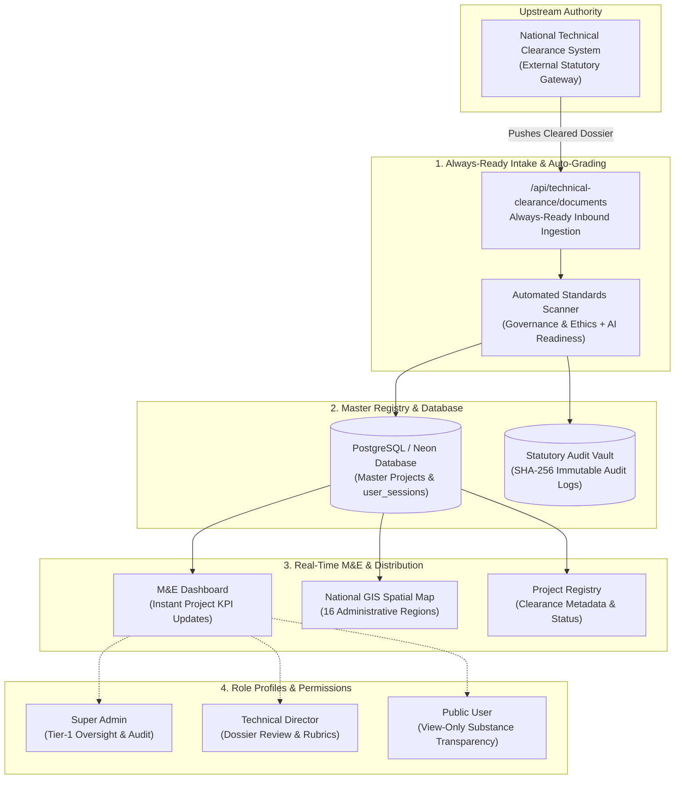
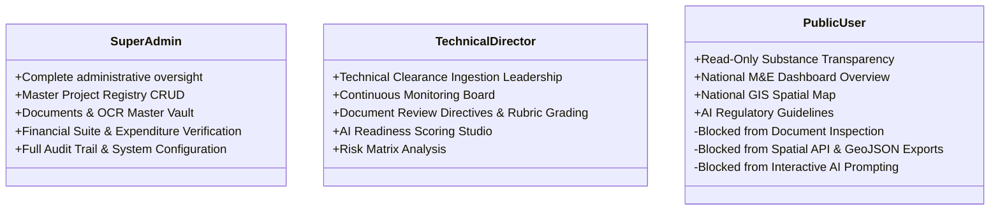

# Republic of Ghana — National AI Projects Registry & Monitoring System (GNAPRMS)
## Master End-to-End System Workflow Specification

```
══════════════════════════════════════════════════════════════════════════════════════════════════════════
  REPUBLIC OF GHANA • NATIONAL INFORMATION TECHNOLOGY AGENCY (NITA)
  Statutory Authority: NITA Act, 2008 (Act 771) • Data Protection Act, 2012 (Act 843) • Cybersecurity Act (Act 1038)
══════════════════════════════════════════════════════════════════════════════════════════════════════════
```

---

## 1. Executive Workflow Architecture

The **Ghana National AI Projects Registry & Monitoring System (GNAPRMS)** operates as the official central registry and continuous monitoring platform for all public sector and sovereign Artificial Intelligence initiatives that have been cleared by the **National Technical Clearance System**. 

The system operates strictly as a **downstream recipient and lifecycle monitor**—receiving cleared project dossiers from the Technical Clearance System, automatically grading them against statutory standards, registering them into the national database, and providing real-time visibility across three distinct user roles.



---

## 2. Detailed Step-by-Step Workflow Phases

### Phase 1: Intake from the National Technical Clearance System
1. **Clearance Issuance**: An MDA (Ministry, Department, or Agency) completes technical clearance with the upstream National Technical Clearance System.
2. **Inbound Dispatch**: The Technical Clearance System transmits the project clearance package directly to GNAPRMS via the dedicated, always-ready endpoint:
   - **Primary Intake Endpoint**: `POST /api/technical-clearance/documents`
   - **Simulation & Health Check**: `POST /api/technical-clearance/simulate-incoming` & `GET /api/technical-clearance/status`
3. **Payload Ingestion**: The inbound package includes the project name, MDA code, clearance certificate, multi-page specifications, vendor metadata, allocated budget, and region.

### Phase 2: Automated Scanning & Standards Auto-Grading
Upon document receipt, GNAPRMS immediately invokes the automated compliance engine:
1. **Governance & Ethics Evaluation**:
   - **Fairness (20%)**: Checks demographic representation, algorithmic bias mitigation, and off-grid inclusion.
   - **Transparency & Explainability (20%)**: Evaluates model architecture documentation and auditability.
   - **Privacy & Data Protection (20%)**: Validates strict compliance with the **Ghana Data Protection Act (Act 843)**.
   - **Safety & Cybersecurity (20%)**: Audits security controls against **Cybersecurity Act 2020 (Act 1038)** and OWASP AI standards.
   - **Accountability & Oversight (20%)**: Assesses institutional ownership and human-in-the-loop governance.
2. **AI Readiness Assessment Framework**:
   - Evaluates institutional compute infrastructure (15%), data readiness (20%), skills & talent (15%), policy & legal framework (10%), and operational integration (15%).
   - **Mandatory Sovereign Parameter — `Verified by NITA (verified by NITA)` (25%)**:
     - *Sub-parameter 1*: `Approved by Technical Director`
     - *Sub-parameter 2*: `Approved by Technical Clearance Team`
     - *Sub-parameter 3*: `Approved by Director General`
3. **Audit Immutability**: Generates an automated audit event with actor, timestamp, and SHA-256 hash stored in `audit_logs`.

### Phase 3: Immediate Master Registry Registration & Dashboard Reflection
1. The project record is inserted into the PostgreSQL `projects` table with initial operational stage and status:
   - Stage: `Planning`, `Development`, or `Operational`.
   - Review Status: `Cleared & Registered` or `Active Monitoring`.
2. **Instant Dashboard Reflection**: The dashboard updates immediately:
   - **Total Cleared AI Projects** KPI increases in real time.
   - **Approved National AI Budget** aggregates newly cleared capital.
   - Sector distributions and regional GIS coordinates reflect the new deployment.

### Phase 4: Lifecycle Monitoring & Oversight
1. **Active Monitoring Board**:
   - Identifies projects requiring attention (`Needs Attention` / `Delayed`).
   - Tracks operational health across agriculture, health, education, security, and financial sectors.
2. **Technical Dossier Verification Studio**:
   - Technical Directors and Super Admins can inspect verbatim uploaded multi-page documents, pass statutory review directives, and calibrate rubric scores.

---

## 3. Role-Based Access Control (RBAC) Matrix

GNAPRMS enforces strictly **three active role profiles**:



| Functional Capability | Super Admin | Technical Director | Public User |
| :--- | :---: | :---: | :---: |
| **M&E Dashboard** | Full Access | Full Access | View-Only Substance |
| **Project Registry CRUD** | Full Access | Ingestion / Monitor | Blocked |
| **GIS Spatial Map** | Full Access | Full Access | View-Only Substance |
| **GIS Spatial Raw Export (GeoJSON/CSV)** | Allowed | Allowed | **Restricted (Act 771)** |
| **PostGIS Spatial API Console** | Full Access | Full Access | **Restricted (Act 771)** |
| **Governance & Ethics Rubric** | Full Access | Review & Grade | Blocked |
| **AI Readiness Evaluation** | Full Access | Review & Grade | Blocked |
| **Documents & OCR Manager** | Full Access | Full Access | Blocked |
| **Inspect Inbound Dossiers** | Allowed | Allowed | **Restricted (Act 771)** |
| **Financial Suite (Act 921)** | Full Access | View Overview | Blocked |
| **Internal Reports Hub** | Full Access | Full Access | Blocked |
| **Statutory Audit Trail** | Full Access | View Logs | Blocked |
| **AI Chat Assistant** | Interactive | Interactive | View-Only Guidelines |

---

## 4. Public User Substance View-Only Security Model

Under the **NITA Act (Act 771)** transparency provisions, citizens are entitled to inspect sovereign progress without exposing classified technical specifications or interactive administrative surfaces.

```
┌────────────────────────────────────────────────────────────────────────┐
│                        PUBLIC USER WORKSPACE                           │
├───────────────────────────────┬────────────────────────────────────────┤
│ What the Public User SEES     │ What the Public User CANNOT ACCESS     │
├───────────────────────────────┼────────────────────────────────────────┤
│ • National AI KPI totals      │ • Cannot inspect raw clearance dossiers│
│ • Sector budget allocations   │ • Cannot review or grade documents     │
│ • Regional deployment maps    │ • Cannot export raw GeoJSON/CSV files  │
│ • Regulatory compliance rubrics│ • Cannot execute PostGIS API queries   │
│ • Official statutory guidance │ • Cannot submit AI assistant prompts   │
└───────────────────────────────┴────────────────────────────────────────┘
```

1. **Dashboard Restrictions**: Dossier inspection buttons are replaced with `🔒 View-Only (Act 771)` lock badges. Navigation to the Document Manager is hidden.
2. **GIS Map Restrictions**: Raw file export buttons are replaced with `🔒 Raw Export: Institutional Only`. The interactive Spatial API Console tab is hidden.
3. **AI Assistant Restrictions**: The message input box is disabled, the send button is locked, and suggested topics serve as read-only informational cards.

---

## 5. Pre-Configured Test Accounts

The mandatory entry gate features a 1-click **Pre-Configured Test Accounts** selector:

| Role Profile | Full Name | Email Address | Password | Managing Institution |
| :--- | :--- | :--- | :--- | :--- |
| **Super Admin** | `Dr. Kwabena Boateng (Super Admin)` | `superadmin@nita.gov.gh` | `SuperAdmin@2026` | National Information Technology Agency (NITA) |
| **Technical Director** | `Eng. Emmanuel Darko (Technical Director)` | `techdirector@mocd.gov.gh` | `TechDirector@2026` | Ministry of Communications and Digitalisation |
| **Public User** | `Kwame Mensah (Citizen Observer)` | `public.user@gov.gh` | `PublicUser@2026` | National Information Technology Agency (NITA) |

---

## 6. System Health & Verification Benchmarks

| Test Suite | Total Tests | Pass Rate | Execution Target |
| :--- | :---: | :---: | :--- |
| **RBAC & Gateway Verification** | 93 Tests | 100% | `node src/tests/run_tests.js` |
| **Technical Clearance Intake** | 7 Tests | 100% | `node src/tests/technical_clearance_intake_tests.js` |
| **Onboarding & Super Admin Workflow** | 16 Tests | 100% | `node src/tests/onboarding_superadmin_workflow_tests.js` |
| **Production Build** | 2,300 Modules | 100% | `tsc && vite build` (Zero Errors) |

---
*Republic of Ghana • National Information Technology Agency (NITA) • All Rights Reserved (2026)*

