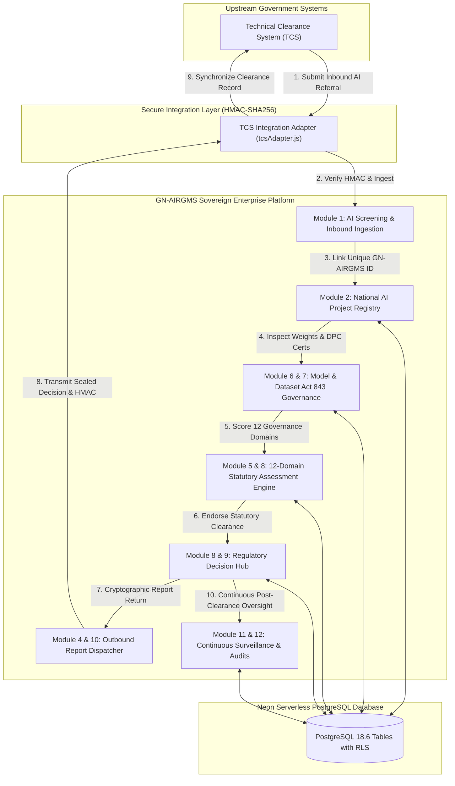
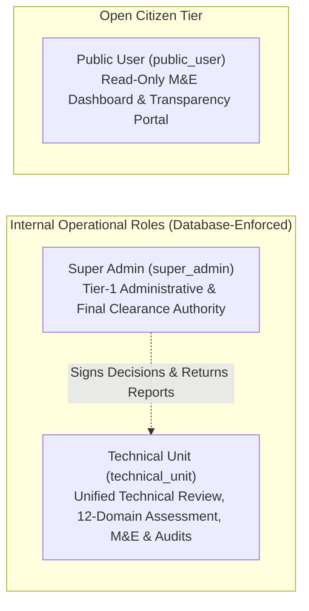

# Republic of Ghana — GN-AIRGMS System Architecture
## Ghana National AI Registry, Governance, Regulatory and Monitoring System
### Statutory Authority: National Information Technology Agency (Act 771), Data Protection Act (Act 843), Cybersecurity Act (Act 1038)

---

## 1. Executive Architectural Overview

The **Ghana National AI Registry, Governance, Regulatory and Monitoring System (GN-AIRGMS)** serves as the sovereign central clearinghouse, registry, and continuous monitoring platform for all artificial intelligence deployments across Ghanaian Ministries, Departments, and Agencies (MDAs), Metropolitan, Municipal, and District Assemblies (MMDAs), and State-Owned Enterprises (SOEs).

GN-AIRGMS operates in tight, bidirectional synergy with Ghana's upstream **Technical Clearance System (TCS)**:
- **TCS:** Manages general technical and business ICT clearances.
- **GN-AIRGMS:** Manages specialized AI identification, algorithmic risk classification, 12-domain statutory governance assessment, model/dataset audit, regulatory clearance decisions, and post-deployment surveillance.

---

## 2. Compressed 2-Tier Role-Based Access Control (RBAC) Architecture

In compliance with administrative security directives, user access is compressed into strictly **two internal operational tiers**, preserving statutory separation of duties while eliminating bureaucratic fragmentation:

### Role Authorization Matrix

| Capability / Action | Super Admin | Technical Unit | Public User |
| :--- | :---: | :---: | :---: |
| View Public Dashboards & GIS Map | Yes | Yes | Yes |
| View National AI Project Registry | Yes | Yes | View Only |
| Ingest & Screen Inbound TCS Referrals | Yes | Yes | No |
| Register AI Models & Fine-Tuning Checkpoints | Yes | Yes | No |
| Audit Datasets & Act 843 DPC Compliance | Yes | Yes | No |
| Score 12-Domain Statutory Assessments | Yes | Yes | No |
| Sign Formal Regulatory Clearance Decisions | **Yes (Final)** | Recommend | No |
| Dispatch Cryptographic Reports to TCS | **Yes** | Yes | No |
| Log & Triage AI Incidents (P1–P4) | Yes | Yes | No |
| Schedule & Sign Off Statutory NITA Audits | Yes | Yes | No |
| Accredit Third-Party AI Vendors | Yes | Yes | No |
| Inspect Tamper-Evident System Audit Logs | Yes | Yes | No |
| Purge / Truncate Immutable Audit Logs | **DENIED** | **DENIED** | **DENIED** |

---

## 3. Database Architecture (Neon PostgreSQL Schema)

GN-AIRGMS operates on a serverless Neon PostgreSQL cluster (AWS `us-east-2`) with Row-Level Security (RLS) active across all 17 tables:

1. **`projects`**: Core project metadata, MDA affiliation, budget, and operational status.
2. **`tcs_referrals`**: Upstream TCS linkage (`tcs_reference_number`), screening flags, and ingestion history.
3. **`ai_models`**: Model architecture, parameter sizes, self-hosted vs cloud deployment, and hallucination guardrails.
4. **`datasets`**: Training corpora, sample size, PII indicators, Act 843 registration certificate, and sovereign data residency.
5. **`assessment_domains`**: 12-domain statutory evaluation scores, risk tiers, and auditor findings.
6. **`regulatory_decisions`**: Official clearance verdicts (`CLEARED`, `CONDITIONAL_CLEARANCE`, `PENDING_REMEDIATION`, `REJECTED`), conditions, and signatures.
7. **`ai_incidents`**: Incident surveillance log, severity tiers (P1–P4), and CAPA action plans.
8. **`ai_audits`**: Scheduled statutory inspections, 8-point NITA checklist results, and conformance ratings.
9. **`ai_vendors`**: Vendor accreditation registry, sovereign data residency vetting, and lock-in risk indices.
10. **`notifications`**: Targeted alerts and compliance milestone warnings.
11. **`institutions`**: Comprehensive national directory of 20+ MDAs, MMDAs, and SOEs.
12. **`audit_logs`**: Forensic append-only audit trail with previous/new value diffs and correlation IDs.
13. **`user_sessions`**: PostgreSQL session store with dynamic database role determination.
14. **`app_versions`**: Application lifecycle releases, patch records, and changelogs.

---

## 4. TCS Bidirectional Communication & Security Protocol

### Inbound Referral (TCS -> GN-AIRGMS)
- **Protocol**: HTTPS POST `/api/tcs/referrals/inbound`
- **Security**: HMAC-SHA256 signature in `X-TCS-Signature` header computed using shared secret.
- **Idempotency**: Checked via unique `tcsReferenceNumber`.

### Outbound Report Dispatch (GN-AIRGMS -> TCS)
- **Protocol**: HTTPS POST `/api/tcs/reports/return`
- **Payload Signature**: Sealed with HMAC-SHA256 signature header and embedded signature token.
- **Acknowledgment**: Upstream TCS returns a unique `acknowledgementToken` verifying receipt.

---

## 5. Continuous Monitoring & 8-Step Lifecycle Enforcement

Post-clearance oversight follows the statutory 8-step lifecycle:
1. **Secure API Exchange**: Initial verified handshake with TCS.
2. **National Registry Validation**: Duplicate scan and parameter completeness.
3. **Risk Classification**: Sectoral sensitivity screening and risk tier assignment.
4. **Regulatory Assessment**: 12-domain technical and ethical evaluation.
5. **Project Implementation**: Milestone progress and pilot deployment verification.
6. **Continuous Monitoring**: Model drift, incident logging, and expenditure auditing.
7. **Audit & Impact Evaluation**: On-site NITA field inspections using the 8-point checklist.
8. **Project Closure or Continued Oversight**: Lifecycle renewal, retirement, or permanent oversight archiving.
