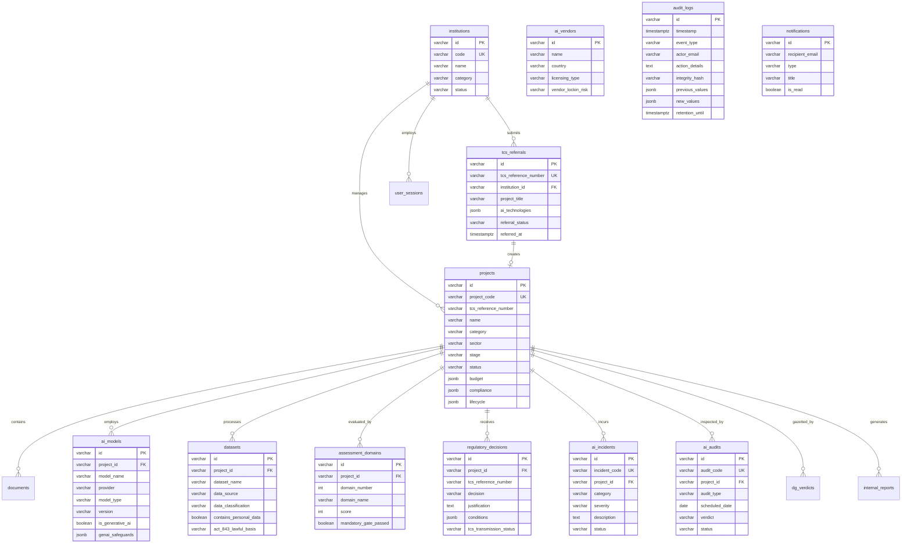

# Republic of Ghana — GN-AIRGMS Database Documentation
## Ghana National AI Registry, Governance, Regulatory & Monitoring System
### Neon Serverless PostgreSQL Database Architecture (PostgreSQL 16+)

```
══════════════════════════════════════════════════════════════════════════════════════════════════════════
  STATUTORY AUTHORITY: National Information Technology Agency (NITA Act, 2008 - Act 771)
  DATA PRIVACY MANDATE: Data Protection Act, 2012 (Act 843)
  CYBERSECURITY RESILIENCE: Cybersecurity Act, 2020 (Act 1038)
  DATABASE PLATFORM: Neon Serverless PostgreSQL (neondb @ AWS us-east-2)
══════════════════════════════════════════════════════════════════════════════════════════════════════════
```

---

## 1. Overview & Architectural Principles

GN-AIRGMS utilizes **Neon Serverless PostgreSQL** for centralized persistence across all government Ministries, Departments, and Agencies (MDAs), Metropolitan, Municipal, and District Assemblies (MMDAs), and State-Owned Enterprises (SOEs).

- **Database Provider**: [Neon](https://neon.tech)
- **Engine**: PostgreSQL 16+ (Serverless with Auto-scaling and Point-In-Time Restore)
- **Driver**: `@neondatabase/serverless` (Native WebSocket/HTTP driver)
- **Connection Model**: Environment-configured connection pooling via `DATABASE_URL` with strict TLS enforcement (`sslmode=require`).
- **Data Integrity & Non-Destruction**: All schema migrations are forward-compatible, non-destructive, and preserve historical records.

---

## 2. Entity Relationship Diagram (ERD)



---

## 3. Database Schema Specification & Data Dictionary

### Core Tables (Baseline)

#### 3.1. `projects`
Stores the central catalog of national AI projects across all MDAs.
- `id` (VARCHAR(100), PK)
- `project_code` (VARCHAR(100), UNIQUE): Statutory project code (e.g., `GN-AI-2026-001`)
- `tcs_reference_number` (VARCHAR(100)): Cross-reference to upstream TCS submission
- `name` (VARCHAR(255)): Project title
- `description` (TEXT): High-level operational summary
- `category` (VARCHAR(100)): ML, Generative AI, Computer Vision, etc.
- `sector` (VARCHAR(100)): Health, Agriculture, Transport, Finance, etc.
- `stage` (VARCHAR(50)): Concept, Planning, Pilot, Operational, etc.
- `status` (VARCHAR(50)): Active, Delayed, Suspended, Completed
- `start_date` / `end_date` / `expected_completion_date` (DATE)
- `latitude` / `longitude` (DOUBLE PRECISION): Spatial GIS coordinates
- `mda` (VARCHAR(255)): Full MDA title (e.g., *Ghana Health Service*)
- `mda_code` (VARCHAR(50)): Institutional shortcode (e.g., *GHS*)
- `budget` (JSONB): Total allocated, disbursed, utilized, and MoF warrant verification
- `compliance` (JSONB): 5-pillar Ethics scores (Fairness, Transparency, Accountability, Privacy, Security)
- `readiness_score` (INTEGER): AI readiness score (0-100%)
- `review_status` (VARCHAR(100)): Statutory clearance status
- `lifecycle` (JSONB): Operational workflow state, milestones, and historical logs
- `documents` (JSONB): Array of attached document metadata
- `ai_classification` (JSONB): Multi-tier classification taxonomy
- `risk_assessment` (JSONB): 14-vector risk evaluation details
- `monitoring_telemetry` (JSONB): Live post-deployment metrics and drift logs
- `created_at` / `updated_at` (TIMESTAMPTZ)

#### 3.2. `documents`
Tracks all uploaded project documents, technical specifications, and ethical charters.
- `id` (VARCHAR(100), PK)
- `project_id` (VARCHAR(100), FK -> projects.id)
- `file_name` (VARCHAR(255))
- `file_type` (VARCHAR(50)): pdf, docx, etc.
- `uploaded_at` (VARCHAR(50))
- `version` (INTEGER)
- `signed_by` (JSONB): Applied digital signatures
- `uploaded_by_mda` (VARCHAR(255))
- `review_status` (VARCHAR(100))
- `document_category` (VARCHAR(255))
- `full_document_text` (TEXT): Verbatim transcript extracted from original upload
- `reviewer_comments` (JSONB): Review directives from clearance authorities

#### 3.3. `institutions`
Directory of public institutions covering Ministries, Departments, Agencies (MDAs), Metropolitan, Municipal, and District Assemblies (MMDAs), and State-Owned Enterprises (SOEs) across Ghana.
- `id` (VARCHAR(100), PK)
- `code` (VARCHAR(50), UNIQUE): Official short identifier (e.g., `NITA`, `MOCD`, `AMA`, `KMA`)
- `name` (VARCHAR(255)): Full statutory name
- `category` (VARCHAR(50)): Classification (`MDA`, `MMDA`, `SOE`, `Regulatory`)
- `sector` (VARCHAR(100)): Primary functional sector
- `status` (VARCHAR(50)): Operational status (`Active`, `Pending`, `Suspended`)
- `contact_email` (VARCHAR(255)): Official administrative contact email
- `region` (VARCHAR(100)): Administrative region (16 regions of Ghana)
- `district` (VARCHAR(100)): Local administrative district
- `active_projects_count` (INTEGER): Cached number of live AI projects

#### 3.4. `audit_logs`
Cryptographically chained, immutable audit trail under Act 843 with field-level forensic diffing.
- `id` (VARCHAR(100), PK)
- `timestamp` (TIMESTAMPTZ)
- `event_type` (VARCHAR(100)): TCS_REFERRAL, ASSESSMENT_SCORE, REGULATORY_DECISION, INCIDENT_LOG, etc.
- `actor_name` / `actor_email` / `actor_role` / `actor_institution` (VARCHAR)
- `target_module` / `target_entity_id` (VARCHAR)
- `action_details` (TEXT)
- `integrity_hash` (VARCHAR(255)): SHA-256 block hash
- `retention_until` (TIMESTAMPTZ): Mandatory statutory retention date (5-7 years under Act 843)
- `previous_values` (JSONB): Pre-modification snapshot of altered record attributes
- `new_values` (JSONB): Post-modification patch values
- `correlation_id` (VARCHAR(100)): Distributed request correlation identifier (`X-Request-ID`)

#### 3.5. `user_sessions`
Authenticated sessions and institutional role assignments across all 13 government roles.
- `id` (VARCHAR(100), PK)
- `email` (VARCHAR(255), UNIQUE)
- `full_name` (VARCHAR(255))
- `institution` (VARCHAR(255))
- `institution_category` (VARCHAR(50))
- `role` (VARCHAR(100))
- `onboarding_status` (VARCHAR(50)): `onboarding`, `pending_approval`, `approved`
- `last_active_at` (TIMESTAMPTZ)

---

### GN-AIRGMS Specialized Tables (Phase 3 Upgrade)

#### 3.6. `tcs_referrals` (Module 1)
Tracks inbound project referrals originating from the upstream Technical Clearance System.
- `id` (VARCHAR(100), PK)
- `tcs_reference_number` (VARCHAR(100), UNIQUE): Upstream identifier (e.g., `TCS-GH-2026-8841`)
- `institution_id` (VARCHAR(100), FK -> institutions.id)
- `institution_name` / `institution_code` (VARCHAR)
- `project_title` (VARCHAR(255))
- `project_description` (TEXT)
- `ai_technologies` (JSONB): Declared AI technology stack
- `intended_use` (TEXT)
- `is_citizen_affecting` (BOOLEAN)
- `is_critical_infrastructure` (BOOLEAN)
- `screening_score` (INTEGER): AI screening questionnaire score (0-100)
- `referral_status` (VARCHAR(50)): `Pending Review`, `Accepted & Registered`, `Returned`, `Rejected`
- `referred_at` (TIMESTAMPTZ)
- `gn_airgms_project_id` (VARCHAR(100), FK -> projects.id)
- `raw_tcs_payload` (JSONB): Immutable raw intake payload

#### 3.7. `ai_models` (Module 6)
Tracks detailed architectural attributes, versioning, and safeguards for AI models.
- `id` (VARCHAR(100), PK)
- `project_id` (VARCHAR(100), FK -> projects.id)
- `model_name` (VARCHAR(255))
- `provider` (VARCHAR(255)): Developer or vendor
- `model_type` (VARCHAR(100)): Foundation Model, Fine-Tuned LLM, CNN, Random Forest, etc.
- `version` (VARCHAR(50))
- `intended_purpose` (TEXT)
- `hosting_location` (VARCHAR(100)): Local sovereign data center or approved host
- `model_ownership` (VARCHAR(100)): State-Owned / Proprietary Vendor
- `accuracy_score` (DOUBLE PRECISION)
- `validation_metrics` (JSONB): Precision, recall, F1, AUC
- `known_limitations` (TEXT)
- `explainability_method` (VARCHAR(100)): SHAP, LIME, Attention Maps
- `bias_testing_status` (VARCHAR(50)): Pending, Passed, Conditional
- `is_generative_ai` (BOOLEAN)
- `genai_safeguards` (JSONB): Prompt defenses, RAG sources, hallucination controls

#### 3.8. `datasets` (Module 6)
Tracks training and validation datasets, provenance, and Data Protection Act (Act 843) compliance.
- `id` (VARCHAR(100), PK)
- `project_id` (VARCHAR(100), FK -> projects.id)
- `dataset_name` (VARCHAR(255))
- `data_source` (VARCHAR(255)): Internal MDA records, Public Registry, Synthetic
- `data_owner` (VARCHAR(255))
- `data_classification` (VARCHAR(50)): Public, Internal, Confidential, Restricted
- `contains_personal_data` (BOOLEAN)
- `act_843_lawful_basis` (VARCHAR(100)): Consent, Legal Obligation, Public Interest
- `consent_documentation_ref` (VARCHAR(255))
- `cross_border_transfer` (BOOLEAN)
- `cross_border_justification` (TEXT)
- `data_retention_period` (VARCHAR(100))
- `quality_score` (INTEGER): Data quality and completeness rating (0-100)

#### 3.9. `assessment_domains` (Modules 4 & 5)
Standardized scoring and evidence logging across the 12 AI assessment domains.
- `id` (VARCHAR(100), PK)
- `project_id` (VARCHAR(100), FK -> projects.id)
- `domain_number` (INTEGER, 1 to 12)
- `domain_name` (VARCHAR(255)): Statutory domain name
- `score` (INTEGER, 1 to 5): Standardized Likert score
- `score_label` (VARCHAR(50)): Very Poor, Poor, Satisfactory, Good, Excellent
- `findings` (TEXT): Assessment observations and analysis
- `evidence_records` (JSONB): Attached documentation references
- `evaluator_name` / `evaluator_role` / `evaluator_email` (VARCHAR)
- `evaluated_at` (TIMESTAMPTZ)
- `mandatory_gate_passed` (BOOLEAN): Critical compliance gate flag

#### 3.10. `regulatory_decisions` (Modules 8 & 9)
Formal decisions issued by regulatory authorities and outbound reports transmitted to TCS.
- `id` (VARCHAR(100), PK)
- `project_id` (VARCHAR(100), FK -> projects.id)
- `tcs_reference_number` (VARCHAR(100))
- `decision` (VARCHAR(100)): Approved/Assessment Satisfactory, Conditionally Approved, Further Assessment Required, Returned for Correction, Rejected, Suspended or Withdrawn
- `justification` (TEXT): Detailed statutory grounds
- `risk_tier_assigned` (VARCHAR(50)): Minimal, Low, Moderate, High, Critical
- `conditions` (JSONB): Structured binding conditions and deadlines
- `decided_by_name` / `decided_by_role` / `decided_by_email` (VARCHAR)
- `decided_at` (TIMESTAMPTZ)
- `signature_seal` (VARCHAR(255)): Cryptographic digital seal
- `tcs_transmission_status` (VARCHAR(50)): `Pending Transmission`, `Transmitted`, `Acknowledged`, `Failed`
- `tcs_transmitted_at` (TIMESTAMPTZ)
- `tcs_acknowledgement_receipt` (VARCHAR(255))

#### 3.11. `ai_incidents` (Module 11)
AI incident reporting, investigation, and root-cause resolution tracking.
- `id` (VARCHAR(100), PK)
- `incident_code` (VARCHAR(100), UNIQUE): E.g., `INC-2026-004`
- `project_id` (VARCHAR(100), FK -> projects.id)
- `institution_id` (VARCHAR(100))
- `incident_date` (TIMESTAMPTZ)
- `category` (VARCHAR(100)): Bias/Discrimination, Privacy Breach, Model Drift, Safety Violation, Cyber Attack
- `severity` (VARCHAR(50)): Low, Medium, High, Critical
- `title` (VARCHAR(255))
- `description` (TEXT)
- `affected_systems` (TEXT)
- `assigned_investigator` (VARCHAR(255))
- `root_cause` (TEXT)
- `corrective_action` (TEXT)
- `status` (VARCHAR(50)): Reported, Under Investigation, Mitigated, Resolved, Closed
- `resolved_at` (TIMESTAMPTZ)

#### 3.12. `ai_audits` (Module 12)
Statutory audit scheduling, checklist findings, and corrective action plans.
- `id` (VARCHAR(100), PK)
- `audit_code` (VARCHAR(100), UNIQUE): E.g., `AUD-2026-012`
- `project_id` (VARCHAR(100), FK -> projects.id)
- `audit_type` (VARCHAR(50)): Statutory Inspection, Post-Deployment Review, Periodic Audit
- `scheduled_date` (DATE)
- `lead_auditor` (VARCHAR(255))
- `audit_team` (JSONB)
- `checklist_findings` (JSONB)
- `non_compliance_records` (JSONB)
- `corrective_action_plan` (TEXT)
- `verdict` (VARCHAR(50)): Scheduled, Satisfactory, Conditional Pass, Action Plan Required, Non-Compliant
- `status` (VARCHAR(50)): Scheduled, In Progress, Completed, Follow-Up Required
- `completed_at` (TIMESTAMPTZ)

#### 3.13. `ai_vendors` (Module 13)
Vendor and procurement oversight, contract terms, data ownership, and lock-in risk.
- `id` (VARCHAR(100), PK)
- `name` (VARCHAR(255)): Vendor enterprise name
- `country` (VARCHAR(100)): Country of incorporation
- `contract_reference` (VARCHAR(100))
- `licensing_type` (VARCHAR(100)): Proprietary, Open Source, Custom Government Build, SaaS
- `data_ownership_clause` (TEXT)
- `hosting_location` (VARCHAR(100))
- `security_certifications` (JSONB): ISO 27001, SOC 2, CSA Star
- `sla_guarantees` (JSONB)
- `vendor_lockin_risk` (VARCHAR(50)): Low, Medium, High, Extreme
- `exit_strategy_documented` (BOOLEAN)

#### 3.14. `notifications` (Section 10)
Centralized system notification dispatch and read-status tracking.
- `id` (VARCHAR(100), PK)
- `recipient_email` (VARCHAR(255))
- `recipient_role` (VARCHAR(100))
- `type` (VARCHAR(50)): TCS_REFERRAL, ASSESSMENT_ASSIGNED, CONDITION_OVERDUE, INCIDENT_ALERT, DRIFT_DETECTED
- `title` (VARCHAR(255))
- `message` (TEXT)
- `project_id` (VARCHAR(100))
- `is_read` (BOOLEAN)
- `delivered_at` (TIMESTAMPTZ)

---

## 4. Migration & Maintenance Commands

```bash
# 1. Execute Non-Destructive GN-AIRGMS Migration (Phase 3):
node server/runMigration.js

# 2. Re-initialize Database Schema and Verify Indexes:
npm run server:init

# 3. Create Full Database Snapshot with SHA-256 Checksum:
node -e "import('./server/backup.js').then(m => m.createDatabaseBackup('Manual Snapshot'))"

# 4. Execute Disaster Recovery & Integrity Drill:
node -e "import('./server/restoreTest.js').then(m => m.runDisasterRecoveryDrill())"
```

---

## 5. Security & Row-Level Security (RLS)

All 17 tables enforce PostgreSQL Row-Level Security:
```sql
ALTER TABLE projects ENABLE ROW LEVEL SECURITY;
ALTER TABLE tcs_referrals ENABLE ROW LEVEL SECURITY;
ALTER TABLE ai_models ENABLE ROW LEVEL SECURITY;
ALTER TABLE datasets ENABLE ROW LEVEL SECURITY;
ALTER TABLE assessment_domains ENABLE ROW LEVEL SECURITY;
ALTER TABLE regulatory_decisions ENABLE ROW LEVEL SECURITY;
ALTER TABLE ai_incidents ENABLE ROW LEVEL SECURITY;
ALTER TABLE ai_audits ENABLE ROW LEVEL SECURITY;
ALTER TABLE ai_vendors ENABLE ROW LEVEL SECURITY;
ALTER TABLE notifications ENABLE ROW LEVEL SECURITY;
ALTER TABLE institutions ENABLE ROW LEVEL SECURITY;
ALTER TABLE app_versions ENABLE ROW LEVEL SECURITY;
ALTER TABLE audit_logs ENABLE ROW LEVEL SECURITY;
```

Application-level policies allow the authenticated connection pool full access while ensuring individual database queries can filter by `institution_id` for tenant data isolation.

---
*Republic of Ghana • National Information Technology Agency (NITA) • All Rights Reserved (2026)*
