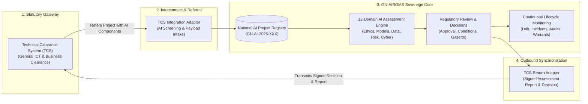
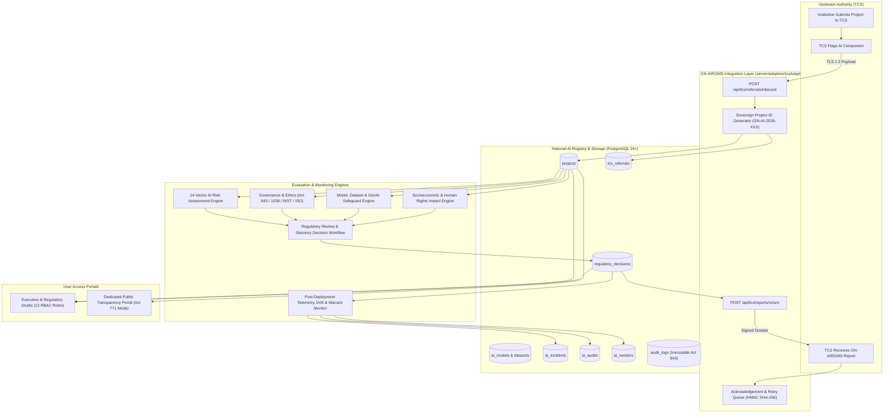

# Republic of Ghana — GN-AIRGMS
## Ghana National AI Registry, Governance, Regulatory & Monitoring System
### Phase 2: Comprehensive System Documentation, SRS & Gap Analysis Report

```
══════════════════════════════════════════════════════════════════════════════════════════════════════════
  STATUTORY AUTHORITY: National Information Technology Agency (NITA Act, 2008 - Act 771)
  DATA SOVEREIGNTY & PRIVACY: Data Protection Act, 2012 (Act 843)
  CYBERSECURITY RESILIENCE: Cybersecurity Act, 2020 (Act 1038)
  NATIONAL ICT ARCHITECTURE: Upstream Technical Clearance System (TCS) Interconnect Mandate
══════════════════════════════════════════════════════════════════════════════════════════════════════════
```

---

## 1. Executive Overview & Purpose

This document constitutes the official **Phase 2 Deliverable** for upgrading the existing application (`Ghana-AI-Project-Tracker-1`) into **GN-AIRGMS (Ghana National AI Registry, Governance, Regulatory and Monitoring System)**.

### Core Strategic Mandate
The existing Ghanaian **Technical Clearance System (TCS)** serves as the sovereign statutory gateway evaluating general business, budgetary, and technical requirements of public sector ICT initiatives. However, general ICT clearance lacks the specialized assessment dimensions necessary for Artificial Intelligence—such as algorithmic bias, foundation model lineage, training data provenance, automated decision explainability, and systemic safety.

**GN-AIRGMS does not replace TCS.** Instead, GN-AIRGMS acts as the **National Specialized AI Clearinghouse, Registry, and Continuous Lifecycle Monitor**. When TCS detects an AI component in an ICT submission, the project is referred to GN-AIRGMS. Following specialized evaluation across 12 statutory domains, an official AI Assessment Report with a binding decision or recommendation is transmitted back to TCS to finalize statutory clearance. GN-AIRGMS then retains continuous oversight throughout the project's operational life.



---

## 2. Current Architecture vs. Target GN-AIRGMS Architecture

### 2.1 Current System Baseline
- **Frontend**: React 18.2.0, TypeScript 5.2.2, Vite 5.1.4, Lucide icons, Recharts visualization library. Single Page Application with 11 primary tabs in `Layout.tsx`.
- **Backend**: Node.js 22, Express 5.3.0 REST API running on port 5000 with 31 endpoints.
- **Database**: Neon Serverless PostgreSQL running on AWS `us-east-2`, 8 core tables (`projects`, `documents`, `dg_verdicts`, `audit_logs`, `internal_reports`, `user_sessions`, `institutions`, `app_versions`), with Row-Level Security enabled.
- **Intake**: One-way inbound intake endpoint (`/api/technical-clearance/documents`).
- **RBAC**: Enforces 3 production roles (`Super Admin`, `Technical Director`, `Public User`) with test account auto-fill.

### 2.2 Target GN-AIRGMS Enterprise Architecture
The target architecture preserves the core foundation while introducing:
1. **Bidirectional TCS Integration Layer**: Implements inbound referral intake (`/api/tcs/referrals/inbound`) and outbound signed assessment delivery (`/api/tcs/reports/return`) with HMAC-SHA256 signature verification and receipt tracking.
2. **Specialized Assessment Subsystems**: Dedicated engines for AI Model evaluation (foundation models, RAG, hallucination controls), Dataset privacy (Act 843 lawful basis, cross-border flows), and Socio-Economic Impact.
3. **Continuous Governance Subsystems**: Dedicated modules for Incident Management & Root Cause Analysis (Module 11), Statutory Audits & Inspections (Module 12), and Vendor & Procurement Oversight (Module 13).
4. **13-Role RBAC Authorization Subsystem**: Expands backend middleware to enforce granular permissions across all 13 government personas.
5. **Separated Public Transparency Portal**: A secure public-facing route completely decoupled from internal regulatory tabs.



---

## 3. Comprehensive Mapping & Gap Analysis of 15 Core Modules

The following section maps the 15 GN-AIRGMS modules specified in the Master Prompt against existing code, identifies reusable components, and defines the exact upgrade specifications.

---

### MODULE 1: AI Project Identification and Automatic Referral

| Parameter | System State & Analysis |
| :--- | :--- |
| **Current Status** | **Partially Implemented** |
| **Existing Components** | `server/index.js` contains inbound intake routes (`/api/technical-clearance/documents`, `/api/technical-clearance/receive`) and simulation harness (`/api/technical-clearance/simulate-incoming`). |
| **Identified Gap** | Lacks a dedicated referral management table (`tcs_referrals`), structured AI screening questions to detect embedded AI in non-AI ICT projects, and an interactive referral review dashboard. |
| **Reusable Assets** | `handleIncomingClearanceDocument` in `server/index.js`, OCR intake parsing in `src/services/assessmentEngine.ts`. |
| **Required Upgrade** | 1. Create table `tcs_referrals` linking `tcs_reference_number` to `gn_airgms_project_id`.<br/>2. Add AI screening questionnaires (10 questions detecting embedded ML, rule engines, computer vision, predictive algorithms, GenAI).<br/>3. Add `TCSReferralManagement.tsx` component allowing regulatory officers to review pending inbound referrals and execute manual referral overrides. |

---

### MODULE 2: National AI Project Registry

| Parameter | System State & Analysis |
| :--- | :--- |
| **Current Status** | **Implemented (Requires Extension)** |
| **Existing Components** | `src/components/ProjectRegistry.tsx`, PostgreSQL `projects` table, and `src/data/sampleProjects.ts` with 12 pre-seeded national projects. |
| **Identified Gap** | Projects do not explicitly link foreign key `tcs_reference_number` to the upstream referral. Filtering by technology classification and sector requires alignment with GN-AIRGMS taxonomy. |
| **Reusable Assets** | Full search, filtering, status badges, GIS coordinate rendering, and budget-in-words converter (`formatNumberToWords`). |
| **Required Upgrade** | 1. Add `tcs_reference_number`, `assigned_officers` JSONB, and `referral_date` columns to `projects` table.<br/>2. Update `ProjectRegistry.tsx` to display official TCS cross-references, assigned assessment teams, and full lifecycle state. |

---

### MODULE 3: AI Project Classification

| Parameter | System State & Analysis |
| :--- | :--- |
| **Current Status** | **Partially Implemented** |
| **Existing Components** | `category` and `sector` fields exist in `sampleProjects.ts` and `projects` table. |
| **Identified Gap** | Lacks multi-dimensional classification distinguishing AI technology (Generative AI, Computer Vision, Biometric AI, Predictive Analytics), application purpose (internal automation vs. citizen-facing decision-making), and critical infrastructure status. |
| **Reusable Assets** | Category and sector dropdowns, sample project classifications. |
| **Required Upgrade** | Introduce a multi-tier classification schema: (1) Technology Category, (2) Autonomy Level (Human-in-the-Loop, Human-on-the-Loop, Full Autonomy), (3) Target Beneficiary (Citizen-facing vs. Internal Agency), (4) Critical Infrastructure Designation (Act 1038 Critical Information Infrastructure). |

---

### MODULE 4: National AI Risk Assessment Engine

| Parameter | System State & Analysis |
| :--- | :--- |
| **Current Status** | **Partially Implemented** |
| **Existing Components** | `src/components/RiskManagement.tsx` provides an interactive 5×5 Likelihood vs. Impact risk matrix with systemic threat logs. |
| **Identified Gap** | Current risk matrix captures generalized risks. It lacks structured evaluation across all 14 mandatory risk vectors (safety, bias, privacy, explainability, cybersecurity, operational risk, environmental impact) and inherent vs. residual ratings. |
| **Reusable Assets** | 5×5 matrix visualizer, SVG heatmaps, risk severity badges. |
| **Required Upgrade** | 1. Create `risk_assessments` table capturing all 14 risk dimensions.<br/>2. Compute Inherent Risk Rating, Mitigating Controls, Responsible Officer, and Residual Risk Rating.<br/>3. Ensure risk ratings inform human decision-makers without automated approvals or rejections. |

---

### MODULE 5: AI Governance and Compliance Assessment

| Parameter | System State & Analysis |
| :--- | :--- |
| **Current Status** | **Implemented (Requires Framework Extension)** |
| **Existing Components** | `src/components/GovernanceCompliance.tsx` audits the Ghana AI Ethics Framework across 5 pillars (Fairness, Transparency, Privacy, Safety, Accountability). |
| **Identified Gap** | Covers Ghanaian legislation (Act 843, Act 1038) well, but lacks international reference standards mapping (NIST AI Risk Management Framework, ISO/IEC 42001, ISO/IEC 23894). |
| **Reusable Assets** | Auto-grading OCR engine in `src/services/assessmentEngine.ts`, statutory pillar scoring bars, compliance radar. |
| **Required Upgrade** | Add dedicated compliance tabs clearly distinguishing statutory Ghanaian laws (Acts 771, 843, 1038) from voluntary international frameworks (NIST, ISO/IEC). Capture compliance statuses: *Compliant*, *Partially Compliant*, *Non-Compliant*, *Not Applicable*, *Evidence Required*. |

---

### MODULE 6: AI Model and Dataset Assessment

| Parameter | System State & Analysis |
| :--- | :--- |
| **Current Status** | **Missing (Foundational JSONB only)** |
| **Existing Components** | Basic `technical_stack` and `vendor` JSONB fields in `projects` table. |
| **Identified Gap** | No dedicated relational storage or UI to evaluate model architecture, versioning, bias testing, explainability methods, training data provenance, Act 843 lawful basis, or Generative AI safeguards (prompts, RAG sources, hallucination controls). |
| **Reusable Assets** | JSONB storage in PostgreSQL. |
| **Required Upgrade** | 1. Create relational tables `ai_models` and `datasets`.<br/>2. Build `src/components/AIModelDatasetStudio.tsx` allowing assessment officers to record foundation model providers, hosting sovereign locations, RAG pipelines, prompt injection safeguards, dataset consent records, and cross-border transfer certificates. |

---

### MODULE 7: AI Impact Assessment

| Parameter | System State & Analysis |
| :--- | :--- |
| **Current Status** | **Missing (High-level workflow fields only)** |
| **Existing Components** | Step 7 of the 8-Step Operational Workflow captures `citizenReach` and `socioEconomicReturnScore`. |
| **Identified Gap** | Lacks a structured 10-point impact assessment measuring baseline conditions, labor market disruption, accessibility for disabled citizens, vulnerable groups inclusion, and environmental sustainability. |
| **Reusable Assets** | Operational workflow impact fields. |
| **Required Upgrade** | Create `impact_assessments` table and UI studio capturing qualitative and quantitative baselines, expected impacts, measurable indicators, and post-deployment actuals. |

---

### MODULE 8: Regulatory Review and Approval Management

| Parameter | System State & Analysis |
| :--- | :--- |
| **Current Status** | **Partially Implemented** |
| **Existing Components** | `server/schema.sql` contains `dg_verdicts` table. Multi-tier recommendation metadata exists in `projects.lifecycle`. |
| **Identified Gap** | Lacks formal committee review multi-signature workflows, condition tracking with statutory deadlines, and the 6 formal decision statuses. |
| **Reusable Assets** | DG verdict database table, cryptographic seal generators, verdict modal. |
| **Required Upgrade** | 1. Implement table `regulatory_decisions` supporting statuses: *Assessment Satisfactory (Approved)*, *Conditionally Approved*, *Further Assessment Required*, *Returned for Correction*, *Rejected*, *Suspended/Withdrawn*.<br/>2. Implement condition tracker tracking binding obligations imposed on MDAs with statutory compliance deadlines. |

---

### MODULE 9: Automatic Decision Report Back to TCS

| Parameter | System State & Analysis |
| :--- | :--- |
| **Current Status** | **Missing** |
| **Existing Components** | One-way intake endpoint exists; no return loop is implemented. |
| **Identified Gap** | No API endpoint transmits assessment outcomes back to TCS, no automated PDF/JSON report compilation, and no acknowledgement receipt tracker exists. |
| **Reusable Assets** | `apiClient.ts` communication structures. |
| **Required Upgrade** | 1. Implement outbound REST endpoint `POST /api/tcs/reports/return` with retry queue and HMAC-SHA256 signature verification.<br/>2. Implement `tcs_acknowledgements` logging receipt timestamps, TCS clearance status updates, and appeal/review windows.<br/>3. Provide a development mock adapter with comprehensive documentation for the TCS technical team. |

---

### MODULE 10: Continuous AI Project Monitoring

| Parameter | System State & Analysis |
| :--- | :--- |
| **Current Status** | **Partially Implemented** |
| **Existing Components** | Step 6 in `OperationalWorkflowStudio.tsx` and `Dashboard.tsx` tracks delayed projects, milestones, and expenditures. |
| **Identified Gap** | Lacks automated alerting for model drift, dataset changes, overdue approval conditions, performance degradation, and periodic statutory reporting schedules. |
| **Reusable Assets** | Operational workflow state engine, milestone tracker. |
| **Required Upgrade** | Build continuous monitoring telemetry tracker with automated trigger alerts when: approval condition is overdue, model version changes, or uptime/accuracy falls below statutory threshold. |

---

### MODULE 11: AI Incident Reporting and Investigation

| Parameter | System State & Analysis |
| :--- | :--- |
| **Current Status** | **Partially Implemented** |
| **Existing Components** | Backend endpoint `POST /api/projects/:id/operational-workflow/incident` logs incidents into `lifecycle.incidents`. |
| **Identified Gap** | Lacks a dedicated Incident Management module with formal incident codes, investigator assignment, evidence attachment, root-cause investigation records, and corrective action closure. |
| **Reusable Assets** | Incident logging API endpoint and operational workflow studio modals. |
| **Required Upgrade** | 1. Create table `ai_incidents`.<br/>2. Implement `src/components/AIIncidentCenter.tsx` providing incident logging, severity triage (Low, Medium, High, Critical), root-cause analysis, and notification alerts. |

---

### MODULE 12: AI Audit and Inspection Management

| Parameter | System State & Analysis |
| :--- | :--- |
| **Current Status** | **Partially Implemented** |
| **Existing Components** | Backend endpoint `POST /api/projects/:id/operational-workflow/inspection` and Step 7 inspection logging. |
| **Identified Gap** | Lacks formal audit schedules, inspection checklists, auditor assignment, non-compliance formal notices, and follow-up inspection tracking. |
| **Reusable Assets** | Inspection logger endpoint and Act 843 audit verification suite. |
| **Required Upgrade** | 1. Create table `ai_audits`.<br/>2. Implement `src/components/AIAuditInspectionHub.tsx` supporting audit schedules, statutory checklists, evidence gathering, and corrective action plans (CAPs). |

---

### MODULE 13: AI Vendor and Procurement Oversight

| Parameter | System State & Analysis |
| :--- | :--- |
| **Current Status** | **Partially Implemented** |
| **Existing Components** | `projects.vendor` JSONB stores vendor name, nationality, and local hosting status. |
| **Identified Gap** | Lacks dedicated contract tracking, licensing models, IP ownership records, vendor lock-in risk scoring, and data residency verification under Act 843. |
| **Reusable Assets** | Zero-assumption audit verification checks in `ProjectRegistry.tsx`. |
| **Required Upgrade** | 1. Create table `ai_vendors`.<br/>2. Implement `src/components/AIVendorOversight.tsx` evaluating vendor country, sovereign data residency, licensing arrangements, and exit strategies. |

---

### MODULE 14: National AI Intelligence Dashboard and GIS

| Parameter | System State & Analysis |
| :--- | :--- |
| **Current Status** | **Implemented (Requires Metric Enrichment)** |
| **Existing Components** | `src/components/Dashboard.tsx` and `src/components/GISGeospatial.tsx` provide 16-region GIS maps, Recharts analytics, and budget aggregations. |
| **Identified Gap** | Dashboard does not currently display TCS referral volume, pending vs. cleared AI assessments, reported incidents breakdown, or local vs. foreign AI technology ratios. |
| **Reusable Assets** | Recharts bar/line/radar visualizers, 16-region coordinate mapping, GIS spatial export tools. |
| **Required Upgrade** | Add TCS referral intake KPIs, incident severity distribution, and Ghanaian-developed vs. imported AI technology ratios to `Dashboard.tsx`. |

---

### MODULE 15: Public Transparency Portal

| Parameter | System State & Analysis |
| :--- | :--- |
| **Current Status** | **Partially Implemented** |
| **Existing Components** | Public User role exists with substance view-only locks on internal tabs. |
| **Identified Gap** | Public User currently navigates the same internal application shell with locked buttons rather than having an isolated, dedicated Public Portal interface that prevents exposure of internal regulatory controls. |
| **Reusable Assets** | Public substance data projections, view-only GIS maps, Act 771 transparency guidelines. |
| **Required Upgrade** | Create an isolated public layout view (`src/components/PublicTransparencyPortal.tsx`) that serves only published, sanitized information (title, institution, general purpose, sector, approved public summary, and national statistics) without internal administrative navigation. |

---

## 4. The 12-Domain Standardized AI Assessment Framework

GN-AIRGMS establishes a unified, structured assessment framework spanning 12 domains. Every domain is evaluated on a standardized 1–5 Likert scale:
- **1 — Very Poor**: Severe deficiencies; violates fundamental statutory or technical standards.
- **2 — Poor**: Insufficient controls; high likelihood of risk realization; non-compliant.
- **3 — Satisfactory**: Meets minimum regulatory baseline; acceptable controls with minor improvements required.
- **4 — Good**: Strong compliance; well-documented controls; robust technical and governance architecture.
- **5 — Excellent**: Industry-leading best practice; comprehensive evidence, auditing, and continuous safeguards.

### Critical Mandatory Compliance Gates
> [!IMPORTANT]
> A high cumulative score does **NOT** override a critical failure in legal, privacy, safety, or human rights compliance. If an AI project fails any of the 4 Mandatory Compliance Gates, it **cannot** receive an "Assessment Satisfactory" status regardless of its overall mathematical average:
> 1. **Gate A: Data Protection Compliance (Act 843)** — Valid registration and lawful basis for personal data processing.
> 2. **Gate B: Cybersecurity & Resilience (Act 1038)** — Secure infrastructure and sovereign hosting validation.
> 3. **Gate C: Human Agency & Oversight** — Mandatory human-in-the-loop mechanism for decisions affecting citizens.
> 4. **Gate D: Safety & Bias Mitigation** — Verified absence of discriminatory algorithmic bias against Ghanaian demographics.

### Domain Breakdown & Scoring Rubric

| Domain | Assessment Scope & Questions | Mandatory Evidence Required | Gate Flag |
| :--- | :--- | :--- | :---: |
| **1. Justification & Intended Use** | Clear problem definition, public benefit rationale, appropriateness of AI over conventional software. | Concept Note, Business Case, Feasibility Study | Normal |
| **2. AI Technology & Models** | Model architecture, foundation model provider, versioning, known limitations, accuracy metrics. | Technical Architecture Document, Model Cards | Normal |
| **3. Data Governance & Privacy** | Lawful basis under Act 843, data lineage, consent mechanisms, cross-border data transfer controls. | DPC Certificate, Data Flow Diagram, Privacy Policy | **GATE A** |
| **4. Fairness & Human Rights** | Bias mitigation across gender, ethnicity, disability, language; constitutional non-discrimination. | Bias Audit Report, Demographic Validation Dataset | **GATE D** |
| **5. Transparency & Explainability** | Interpretability of algorithmic decisions, auditability of inference logs, user explainability interfaces. | Explainability Methodology, Decision Audit Trail | Normal |
| **6. Human Oversight & Agency** | Human-in-the-loop (HITL) procedures, override capabilities, appeals mechanisms for affected citizens. | Standard Operating Procedures (SOPs), Human Escalation Plan | **GATE C** |
| **7. Cybersecurity & Resilience** | Vulnerability assessments, prompt injection defenses, model theft protections, Act 1038 compliance. | Cybersecurity Audit Report, Penetration Test Sign-Off | **GATE B** |
| **8. Legal & Regulatory Compliance** | Compliance with sector regulations (BoG, NCA, FDA, EPA), public procurement, and copyright laws. | Statutory Legal Opinion, Procurement Clearance | Normal |
| **9. Operational Readiness** | Institutional compute capacity, network reliability, operational personnel training, SLA definitions. | Infrastructure Audit, Capacity Building Plan | Normal |
| **10. Third-Party & Vendor Risk** | Vendor dependency, proprietary lock-in risks, sovereign code ownership, exit arrangements. | Vendor Contract, Escrow Agreement, SLA | Normal |
| **11. Socioeconomic & Environmental** | Labor market impact, digital divide effects, compute energy consumption, carbon footprint. | Impact Assessment, Environmental Statement | Normal |
| **12. Post-Deployment Monitoring** | Model drift detection, retraining protocols, continuous incident logging, audit schedules. | Continuous Monitoring Plan, Incident Escalation SLA | Normal |

---

## 5. User Roles and Access Control Matrix (Streamlined 2-Tier Internal Architecture)

Per government optimization directives, GN-AIRGMS eliminates organizational role bloat by consolidating all operational responsibilities into a **streamlined 2-tier internal architecture**:

1. **Super Administrator (`super_admin`) — Stands Alone**:
   - Holds exclusive, complete administrative and sovereign authority over the entire platform.
   - Manages system configuration, user accounts, institutions directory, version deployments, and disaster recovery.
   - Retains final authority for approving statutory decisions, gazetting clearances, and executing cryptographic audit purges.

2. **Technical Unit (`technical_unit`) — Consolidated Technical Directorate**:
   - Compresses all technical, regulatory, assessment, governance, M&E, audit, and monitoring specialist functions into one unified operational role.
   - Handles:
     - Technical Clearance Ingestion & TCS referral screening.
     - 12-domain AI assessment evaluations and scoring.
     - Model & Dataset provenance and GenAI safeguard assessments.
     - 14-vector Risk Matrix analysis and mitigation tracking.
     - Governance and ethics audits under Act 843 and Act 1038.
     - Post-deployment continuous monitoring and incident investigations.
     - Statutory audits, inspections, and vendor procurement oversight.
     - Recommending regulatory decisions for final Super Admin endorsement.

*(External Citizen Access is preserved via **Public User (`public_user`)** for transparent, view-only public information).*

### Granular Authorization Matrix (2-Tier Architecture)

| System Module | Super Admin (Stands Alone) | Technical Unit (Compressed) | Public User (Citizen Observer) |
| :--- | :---: | :---: | :---: |
| **M&E Dashboard** | Full Control | Full Operational View | Substance View-Only |
| **Project Registry** | Full CRUD | Ingest, Review & Update | Blocked |
| **TCS Referral Intake** | Full Control | Review, Screen & Process | Blocked |
| **AI Classification Engine** | Full Control | Classify & Calibrate | Blocked |
| **National AI Risk Engine** | Full Control | Inherent & Residual Scoring | Blocked |
| **Governance & Ethics** | Full Control | Audit & Grade Rubrics | Blocked |
| **Model & Dataset Studio** | Full Control | Inspect Architecture & Data | Blocked |
| **Impact Assessment** | Full Control | Evaluate Socioeconomic Indicators | Blocked |
| **Regulatory Decisions** | Final Approval & Sign-Off | Review & Recommend Decisions | Blocked |
| **TCS Outbound Dispatcher** | Full Transmission Authority | Stage & Queue Reports | Blocked |
| **Continuous Monitoring** | Full Control | Telemetry & Drift Monitoring | Blocked |
| **Incident Investigation** | Full Control | Log, Triage & Investigate | Blocked |
| **Audit & Inspection Hub** | Full Control | Schedule, Audit & Action Plans | Blocked |
| **Vendor & Procurement** | Full Control | Vendor Oversight & SLA Review | Blocked |
| **System Settings & RLS** | Full Control | Blocked | Blocked |
| **Public Transparency Portal**| Full Control | View | Full Access (Sanitized) |

---

## 6. TCS Integration Specification (Bidirectional Protocol)

### 6.1 Inbound Referral Protocol (TCS → GN-AIRGMS)
- **Endpoint**: `POST /api/tcs/referrals/inbound`
- **Security**: TLS 1.3, Bearer Token authentication, HMAC-SHA256 request payload signature header (`X-TCS-Signature`).
- **Idempotency**: Requests must provide `X-Idempotency-Key` based on the original `tcsReferenceNumber`.
- **Payload Schema**:
```json
{
  "tcsReferenceNumber": "TCS-GH-2026-8841",
  "referralDate": "2026-11-12T14:30:00Z",
  "institution": {
    "code": "MOH",
    "name": "Ministry of Health",
    "category": "MDA",
    "contactPerson": "Dr. Anthony Adofo",
    "contactEmail": "a.adofo@moh.gov.gh"
  },
  "project": {
    "title": "National Diagnostic Radiology AI Triaging Engine",
    "description": "Deep learning chest X-ray triage assistant deployed across regional hospitals.",
    "sector": "Health",
    "allocatedBudgetGHS": 4500000,
    "fundingSource": "Government / World Bank",
    "implementationStartDate": "2027-01-15",
    "expectedCompletionDate": "2028-12-31",
    "projectLocation": {
      "region": "Greater Accra",
      "district": "Accra Metropolitan",
      "latitude": 5.6037,
      "longitude": -0.1870
    }
  },
  "aiDeclaration": {
    "hasAITechnology": true,
    "technologyTypes": ["Deep Learning", "Computer Vision"],
    "intendedUse": "Clinical diagnostic triage of pulmonary anomalies",
    "isCitizenAffecting": true,
    "isCriticalInfrastructure": true,
    "foundationModel": "DenseNet-121-GhanaRadiology-v2",
    "primaryVendor": "MedAI Solutions Ghana Ltd."
  },
  "supportingDocuments": [
    {
      "documentType": "Technical Specification",
      "fileName": "MOH_Radiology_AI_TechSpec.pdf",
      "fileUrl": "https://tcs.gov.gh/vault/docs/8841/spec.pdf",
      "sha256Hash": "e3b0c44298fc1c149afbf4c8996fb92427ae41e4649b934ca495991b7852b855"
    }
  ]
}
```

- **GN-AIRGMS Response**:
```json
{
  "status": "ACCEPTED",
  "statusCode": 202,
  "gnAirgmsProjectId": "GN-AI-2026-013",
  "tcsReferenceNumber": "TCS-GH-2026-8841",
  "referralStatus": "Referred & Registered",
  "acknowledgementToken": "ACK-GNAIRGMS-2026-99214",
  "assignedAssessmentTeam": "Health Sector AI Regulatory Directorate",
  "estimatedReviewDays": 14,
  "timestamp": "2026-11-12T14:30:02Z"
}
```

---

### 6.2 Outbound Report Protocol (GN-AIRGMS → TCS)
- **Endpoint**: `POST /api/tcs/reports/return` (or external TCS URL `https://tcs.gov.gh/api/v1/ai-assessment/callback`)
- **Security**: TLS 1.3, Mutual TLS / HMAC-SHA256 signature signed with NITA private key.
- **Payload Schema**:
```json
{
  "gnAirgmsProjectId": "GN-AI-2026-013",
  "tcsReferenceNumber": "TCS-GH-2026-8841",
  "decisionDate": "2026-11-20T10:15:00Z",
  "decision": "Conditionally Approved",
  "riskClassification": "High Risk",
  "overallAssessmentScore": 4.15,
  "mandatoryComplianceGates": {
    "act843DataProtection": "PASSED",
    "act1038Cybersecurity": "PASSED",
    "humanAgencyOversight": "PASSED",
    "safetyAndBiasMitigation": "PASSED"
  },
  "domainScores": {
    "justification": 4.8,
    "aiTechnology": 4.2,
    "dataGovernance": 4.0,
    "fairness": 4.0,
    "transparency": 3.8,
    "humanOversight": 4.5,
    "cybersecurity": 4.6,
    "legalCompliance": 4.2,
    "operationalReadiness": 3.9,
    "vendorRisk": 3.7,
    "socioeconomicImpact": 4.5,
    "postDeploymentMonitoring": 3.6
  },
  "bindingConditions": [
    {
      "conditionId": "COND-2026-013-1",
      "requirement": "Radiologist final confirmation must be logged for 100% of diagnostic outputs.",
      "deadline": "2027-01-31",
      "statutoryBasis": "Health Professions Regulatory Bodies Act, 2013 (Act 857)"
    },
    {
      "conditionId": "COND-2026-013-2",
      "requirement": "Model retraining telemetry must be submitted quarterly to NITA.",
      "deadline": "2027-04-30",
      "statutoryBasis": "NITA Act, 2008 (Act 771)"
    }
  ],
  "authorizedSignatories": [
    {
      "name": "Eng. Emmanuel Darko",
      "role": "Technical Director, NITA",
      "signatureSeal": "NITA-SIG-SEAL-88219"
    },
    {
      "name": "Dr. Kwabena Boateng",
      "role": "Super Administrator / Regulatory DG",
      "signatureSeal": "DG-GAZETTE-SEAL-44102"
    }
  ],
  "dossierDownloadUrl": "https://ai-tracker.gov.gh/api/reports/GN-AI-2026-013/official-dossier.pdf",
  "dossierSha256Checksum": "7d8e4f16b230985a9bc694129e61db1e2f7b198c801b6441e8c201659a850123"
}
```

- **TCS Expected Acknowledgement**:
```json
{
  "tcsAcknowledgement": "RECEIVED_AND_PROCESSED",
  "tcsReferenceNumber": "TCS-GH-2026-8841",
  "tcsUpdatedStatus": "AI Clearance Complete - Conditional Clearance Issued",
  "receiptTimestamp": "2026-11-20T10:15:04Z",
  "tcsClearingOfficer": "Chief Technical Examiner, TCS"
}
```

---

## 7. Database Migration & Schema Design (Phase 3 Blueprint)

To upgrade the database cleanly without altering or deleting existing tables, Phase 3 will execute a non-destructive schema migration:

```
Existing Tables (Preserved):
  ├── projects (12 rows) [Add: tcs_reference_number, referral_date]
  ├── documents (0 rows)
  ├── dg_verdicts (3 rows)
  ├── audit_logs (3 rows) [Forensic diffs preserved]
  ├── internal_reports (1 row)
  ├── user_sessions (3 rows) [Expanded to 13 roles]
  ├── institutions (20 rows) [MDAs, MMDAs, SOEs]
  └── app_versions (1 row)

New Specialized Relational Tables (To Be Added):
  ├── tcs_referrals (Tracks inbound project referrals from TCS)
  ├── ai_models (Tracks model architecture, version, GenAI safeguards)
  ├── datasets (Tracks training data provenance, Act 843 basis, cross-border flows)
  ├── assessment_domains (Stores 12-domain scores, findings, comments, evidence)
  ├── regulatory_decisions (Stores formal decisions, conditions, and TCS return status)
  ├── ai_incidents (Tracks incident reports, severity, root cause, resolution)
  ├── ai_audits (Tracks audit schedules, checklists, findings, corrective action plans)
  ├── ai_vendors (Tracks vendor contracts, licensing, hosting, and lock-in risks)
  └── notifications (In-app and email notification delivery log)
```

---

## 8. Frontend Interface Layout & Screen Architecture

The UI will be organized in `src/components/Layout.tsx` into 6 clear functional clusters to prevent navigation clutter:

1. **National Registry & Ingestion**:
   - M&E Executive Dashboard (`Dashboard.tsx`)
   - National AI Project Registry (`ProjectRegistry.tsx`)
   - TCS Inbound Referral Console (`TCSReferralConsole.tsx`)
   - National GIS Spatial Map (`GISGeospatial.tsx`)
2. **Specialized AI Assessment Studios**:
   - 12-Domain AI Assessment Studio (`AIAssessmentStudio.tsx`)
   - AI Model & Dataset Studio (`AIModelDatasetStudio.tsx`)
   - Governance & Compliance Studio (`GovernanceCompliance.tsx`)
   - National AI Risk Engine (`RiskManagement.tsx`)
3. **Decisions & Regulatory Clearance**:
   - Regulatory Review & Decision Vault (`RegulatoryDecisionVault.tsx`)
   - TCS Return & Report Dispatcher (`TCSReturnDispatcher.tsx`)
   - Documents & Technical OCR Manager (`DocumentManager.tsx`)
4. **Post-Deployment Monitoring**:
   - Continuous Monitoring & Drift Center (`ContinuousMonitoring.tsx`)
   - AI Incident Investigation Center (`AIIncidentCenter.tsx`)
   - Statutory Audit & Inspection Hub (`AIAuditInspectionHub.tsx`)
   - Vendor & Procurement Oversight (`AIVendorOversight.tsx`)
5. **Intelligence, Fiscal & Auditing**:
   - Financial Suite & MoF Warrants (`FinanceMinisterView.tsx`)
   - Internal Classified Reports (`InternalReportsHub.tsx`)
   - Act 843 Forensic Audit Trail (`AuditLogViewer.tsx`)
   - Sovereign AI Policy Assistant (`AIChatAssistant.tsx`)
6. **Public Portal**:
   - Dedicated Public Transparency Portal (`PublicTransparencyPortal.tsx`)

---

## 9. Phase-by-Phase Roadmap and Sign-Off

```mermaid
gantt
    title GN-AIRGMS Implementation Roadmap
    dateFormat  YYYY-MM-DD
    section Completed
    Phase 1: Inspection & Assessment       :done, p1, 2026-11-12, 1d
    Phase 2: Documentation & Gap Analysis  :done, p2, 2026-11-12, 1d
    section Next Phases
    Phase 3: Database Migrations           :active, p3, 2026-11-13, 1d
    Phase 4: Backend APIs & TCS Adapter    :p4, 2026-11-14, 2d
    Phase 5: Frontend Studios              :p5, 2026-11-16, 2d
    Phase 6: Module Integration            :p6, 2026-11-18, 1d
    Phase 7: Persistence & API Tests       :p7, 2026-11-19, 1d
    Phase 8: 13-Role RBAC Testing          :p8, 2026-11-20, 1d
    Phase 9: End-to-End Workflow Drill     :p9, 2026-11-21, 1d
    Phase 10: Final Documentation          :p10, 2026-11-22, 1d
    Phase 11: Staging & Handover           :p11, 2026-11-23, 1d
```

### Readiness Checklist for Phase 3 (Database Upgrade):
- [x] Full database backup script operational (`server/backup.js`).
- [x] DR integrity drill verified with RTO SLA of <0.12s.
- [x] Non-destructive DDL migrations prepared without drop or truncate commands.
- [x] 139 existing automated tests verified and passing at 100%.
- [x] Current system running live locally on ports 3000 and 5000.

---
*Republic of Ghana • National Information Technology Agency (NITA) • All Rights Reserved (2026)*

