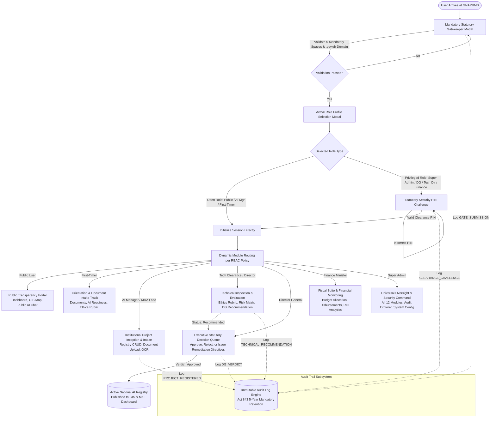
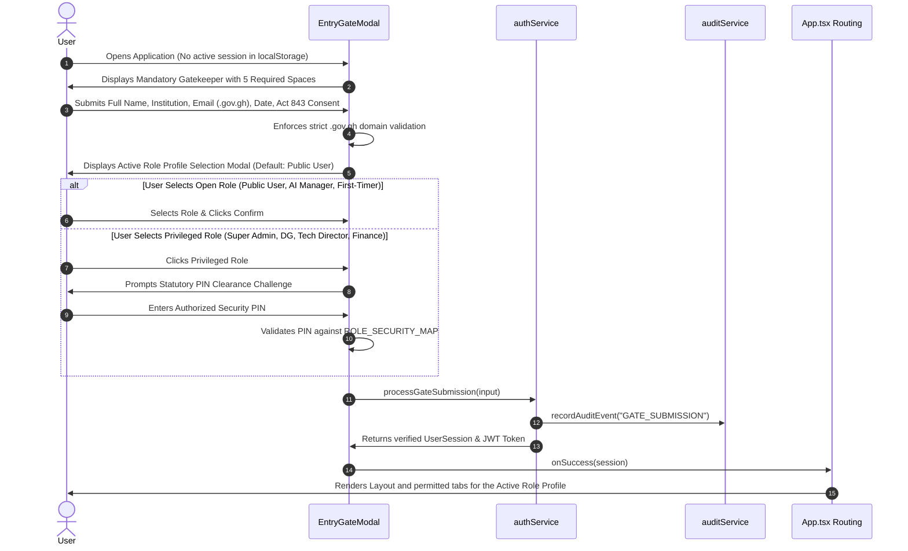
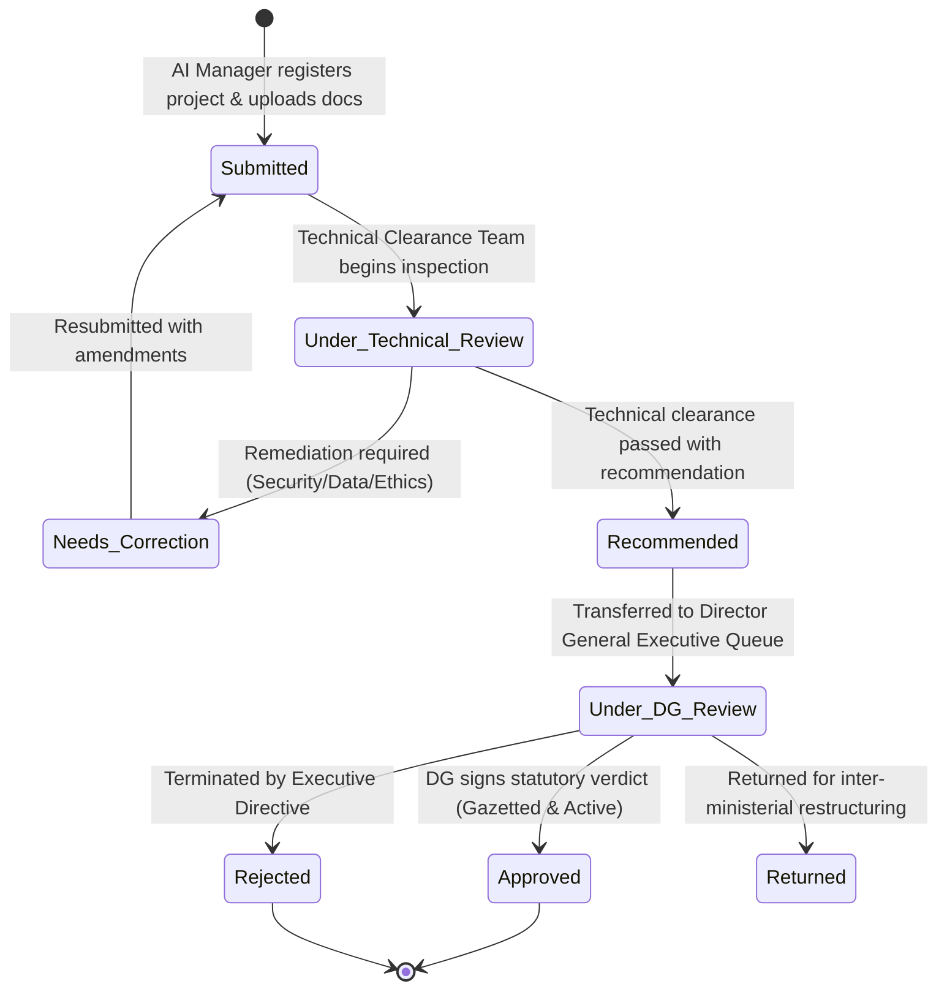
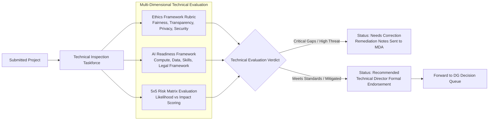
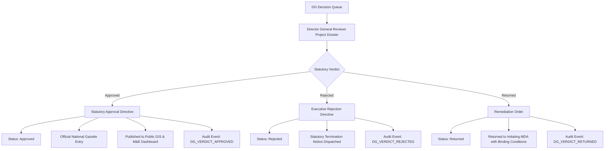
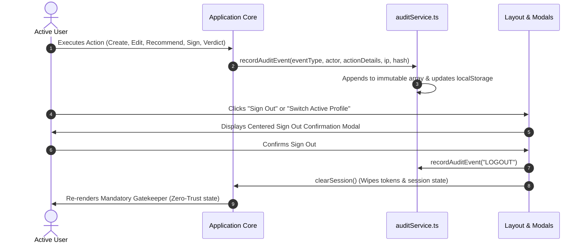

# Ghana National AI Projects Registry & Monitoring System (GNAPRMS)
## Comprehensive End-to-End System Workflow Specification

> [!NOTE]
> **Statutory Authority**: National Information Technology Agency (NITA) under the Ministry of Communications and Digitalisation (MOCD), complying with the **Data Protection Act, 2012 (Act 843)** and the **National AI Policy Framework of Ghana**.

---

## 1. System Architecture Overview

The **GNAPRMS** platform serves as Ghana's sovereign digital clearinghouse and monitoring registry for all Artificial Intelligence implementations across Ministries, Departments, Agencies (MDAs), Metropolitan, Municipal, and District Assemblies (MMDAs), State-Owned Enterprises (SOEs), and partner organizations.

The system enforces a strict **Zero-Trust Statutory Gatekeeper**, deterministic **Role-Based Access Control (RBAC)** across 8 specialized roles and 12 modules, a multi-tier **Technical Inspection & Executive Clearance Pipeline**, and an **Immutable 5-Year Audit Trail**.

---

## 2. Phase 1: Statutory Gatekeeper & Authentication Workflow

Every user entering the system is treated as a first-time visitor until validated through the mandatory gatekeeper in [`src/components/EntryGateModal.tsx`](../src/components/EntryGateModal.tsx).

### The 5 Mandatory Gatekeeper Spaces

| # | Space | Field Specification | Statutory Validation Rule |
| :--- | :--- | :--- | :--- |
| **1** | **FULL NAME** | Officer or Citizen full legal identity | Non-empty string; recorded in audit trail for non-repudiation. |
| **2** | **MANAGING INSTITUTION** | MDA, MMDA, SOE dropdown with search or Custom Entry | Mapped to [`STANDARD_INSTITUTIONS`](../src/data/authTypes.ts) or custom validated entity. |
| **3** | **EMAIL ADDRESS** | Institutional official email | **Strict Domain Enforcement**: Must end with `.gov.gh` (e.g. `nita.gov.gh`, `mof.gov.gh`, `mocd.gov.gh`). |
| **4** | **DATE** | Access timestamp | Defaults to current date; immutable session creation marker. |
| **5** | **GHANA DATA PROTECTION ACT** | Statutory consent checkbox | Explicit legal affirmation under **Data Protection Act, 2012 (Act 843)** acknowledging 5-year cryptographic logging. |

### Statutory Role Clearance & Protection

To prevent public visitors or low-privilege actors from unauthorized administrative access, high-privilege profiles require cryptographic/statutory PIN verification:

| Active Role Profile | Access Category | Clearance Authority | Statutory PIN |
| :--- | :--- | :--- | :--- |
| **Public User** | **Open** | Citizen Transparency Access | *None (Immediate Access)* |
| **AI Manager** | **Open** | Institutional Project Inception Lead | *None (Institutional Intake)* |
| **First-Timer / New User** | **Open** | Orientation & Onboarding Track | *None (Guided Track)* |
| **Super Admin** | **Restricted 🔒** | NITA Cyber Security Command | `NITA-ADMIN-2026` |
| **Director General** | **Restricted 🔒** | Executive Statutory Office | `DG-CLEARANCE` |
| **Technical Director** | **Restricted 🔒** | Technical Operations Directorate | `TECH-DIR-2026` |
| **Technical Clearance Team**| **Restricted 🔒** | AI Technical Inspection Taskforce | `INSPECT-2026` |
| **Finance Minister** | **Restricted 🔒** | Sovereign Fiscal Authority (MOF) | `MOF-FISCAL-2026` |

---

## 3. Phase 2: Project Inception, Registration & Document OCR Pipeline

Once inside the system, the project lifecycle follows a structured state progression:

### Steps in Phase 2
1. **Intake & Taxonomy Configuration** ([`src/components/ProjectRegistry.tsx`](../src/components/ProjectRegistry.tsx)):
   - **Managing MDA**: Selecting initiating institution (e.g., *Ministry of Health*, *GRA*, *Ghana Police*).
   - **Sectoral Classification**: Healthcare, Agriculture, Revenue & Taxation, Law Enforcement, Governance, Education.
   - **Geographic Coordinates**: Assigning regional centroid (16 Regions of Ghana) for GIS visualization.
   - **Fiscal Parameters**: Initial budget allocation (GHS/USD), primary funding source (*Government*, *Development Partners*, *Research Grants*).
2. **Document & Compliance Asset Upload** ([`src/components/DocumentManager.tsx`](../src/components/DocumentManager.tsx)):
   - Mandatory statutory documentation:
     - Data Protection Impact Assessment (DPIA) under Act 843.
     - Algorithmic Architecture & System Design Specification.
     - Model Card & Training Data Provenance Documentation.
     - Cyber Security Audit Certificate.
   - **OCR Extraction**: Automated optical character recognition parses uploaded documents to extract compliance keywords, dates, and sign-offs.
   - **Cryptographic Signatures**: Authorized officers apply digital signatures logged with timestamp and user email.

---

## 4. Phase 3: Technical Clearance & Statutory Evaluation Pipeline

Projects in `Submitted` status are claimed by the **Technical Clearance Team** and **Technical Director**.

1. **Governance & Ethics Evaluation** ([`src/components/GovernanceCompliance.tsx`](../src/components/GovernanceCompliance.tsx)):
   - Evaluates the 5 pillars of the Ghana AI Ethics Policy:
     - **Fairness Index (0-100%)**: Demographic parity, mitigation of regional/tribal bias.
     - **Transparency Index (0-100%)**: Explainability of algorithmic decisions and auditable outputs.
     - **Accountability Index (0-100%)**: Clearly designated institutional human-in-the-loop oversight.
     - **Privacy Index (0-100%)**: Strict Act 843 compliance and consent mechanisms.
     - **Security Index (0-100%)**: Model resilience against adversarial manipulation and data poisoning.
   - Calculates overall compliance score: *Excellent*, *Good*, *Moderate*, or *High Risk*.
2. **AI Readiness Assessment** ([`src/components/AIReadiness.tsx`](../src/components/AIReadiness.tsx)):
   - Institutional capability scored across Computing Infrastructure, Data Governance Maturity, Human Capital, and Regulatory Alignment.
3. **5x5 Systemic Risk Matrix** ([`src/components/RiskManagement.tsx`](../src/components/RiskManagement.tsx)):
   - Tracks threat vectors across Likelihood (1-5) and Impact (1-5).
   - Generates composite risk score: *Low (1-6)*, *Medium (8-12)*, *High (15-16)*, *Critical (20-25)*.
   - Enforces required mitigation strategies before a project can be recommended.
4. **Recommendation to DG**:
   - The Technical Reviewer enters formal review notes, appends their identity, and transitions status to `Recommended`.

---

## 5. Phase 4: Executive Decision Pipeline (Director General Queue)

Projects with status `Recommended` appear exclusively in the **DG Decision Queue** ([`src/components/DGDecisionQueue.tsx`](../src/components/DGDecisionQueue.tsx)).

- **Statutory Isolation**: Under [`src/services/rbacPolicy.ts`](../src/services/rbacPolicy.ts), the Director General is isolated from operational CRUD editing in the registry or threat tampering in the risk matrix. The DG acts solely as the sovereign executive clearing authority.
- **Formal Directives**: Every verdict requires a legal directive summary, timestamped and cryptographically linked to the DG's session.

---

## 6. Phase 5: Continuous Monitoring, Geospatial & Fiscal Tracking

Once approved, projects enter active real-time national surveillance across three core oversight suites:

### 1. National M&E Dashboard ([`src/components/Dashboard.tsx`](../src/components/Dashboard.tsx))
- Real-time aggregations of Total Registered Projects, Total National Investment, Average Compliance Grade, and Active Deployments.
- Breakdown by lifecycle stage (*Inception*, *Piloting*, *Production*, *Scaling*).
- Cross-sector distribution graphs.

### 2. GIS Geospatial Intelligence ([`src/components/GISGeospatial.tsx`](../src/components/GISGeospatial.tsx))
- Interactive Leaflet-powered mapping of Ghana's 16 administrative regions.
- Regional allocation tracking, identifying regional concentration and rural technology deserts.
- Coordinates, project details, and sector tags for every active deployment.

### 3. Sovereign Fiscal Suite ([`src/components/FinanceMinisterView.tsx`](../src/components/FinanceMinisterView.tsx))
- Dedicated interface for the **Ministry of Finance (MOF)**.
- Tracks:
  - Budget Allocated vs Disbursed vs Utilized.
  - Funding source breakdowns (*Government Consolidated Fund*, *World Bank*, *Bilateral Grants*).
  - Currency conversion and burn rates (GHS & USD).
  - One-click statutory financial export (CSV / PDF ready).

### 4. Public AI Chat Assistant ([`src/components/AIChatAssistant.tsx`](../src/components/AIChatAssistant.tsx))
- Citizen and institutional assistant capable of querying registered AI projects, understanding Ghana's AI Ethics principles, and retrieving regional deployment summaries.

---

## 7. Phase 6: Immutable Audit Trail & Session Lifecycle

- **Act 843 Compliance**: Section 18 of the Data Protection Act mandates audit retention. The system captures:
  - Event ID & Timestamp.
  - Actor Full Name, Email, Institutional Code, and Active Role.
  - Target Module and Target Project ID.
  - Detailed Action Narrative & Payload Digest.
- **Audit Explorer** ([`src/components/AuditLogViewer.tsx`](../src/components/AuditLogViewer.tsx)): Allows Super Admins and Security Officers to filter, inspect, and export audit trails.

---

## 8. Role-Based Access Control (RBAC) Master Matrix

| System Module | Public User | First-Timer | AI Manager | Tech Clearance | Tech Director | Director General | Finance Minister | Super Admin |
| :--- | :---: | :---: | :---: | :---: | :---: | :---: | :---: | :---: |
| **M&E Dashboard** | ✅ *(Public)* | ❌ | ✅ | ✅ | ✅ | ✅ *(Exec)* | ✅ *(Fiscal)* | ✅ |
| **Project Registry** | ❌ | ❌ | ✅ *(Intake)*| ✅ *(Inspect)*| ✅ *(Edit)* | ❌ *(Isolated)*| ❌ *(Isolated)* | ✅ *(Full)* |
| **GIS Spatial Map** | ✅ *(Public)* | ❌ | ✅ | ✅ | ✅ | ✅ | ❌ *(Isolated)* | ✅ |
| **Governance & Ethics** | ❌ | ✅ *(Guide)* | ✅ | ✅ | ✅ | ❌ *(Isolated)*| ❌ *(Isolated)* | ✅ |
| **AI Readiness** | ❌ | ✅ *(Guide)* | ✅ | ✅ | ✅ | ❌ *(Isolated)*| ❌ *(Isolated)* | ✅ |
| **Risk Matrix** | ❌ | ❌ | ✅ | ✅ | ✅ | ❌ *(Isolated)*| ❌ *(Isolated)* | ✅ |
| **Documents & OCR** | ❌ | ✅ *(Upload)*| ✅ | ✅ | ✅ | ❌ *(Isolated)*| ❌ *(Isolated)* | ✅ |
| **DG Decision Queue** | ❌ | ❌ | ❌ | ❌ | 👁️ *(Preview)*| ✅ *(Verdicts)*| ❌ *(Isolated)* | ✅ |
| **Financial Suite** | ❌ | ❌ | ❌ | ❌ | ❌ | ✅ *(Overview)*| ✅ *(Full MOF)*| ✅ |
| **Internal Reports** | ❌ | ❌ | ❌ | ✅ | ✅ | ✅ | ❌ *(Isolated)* | ✅ |
| **Audit Trail Explorer**| ❌ | ❌ | ❌ | ❌ | ❌ | ✅ *(Read)* | ❌ *(Isolated)* | ✅ *(Full)* |
| **AI Chat Assistant** | ✅ *(Public)* | ❌ | ✅ | ✅ | ✅ | ❌ | ✅ | ✅ |
